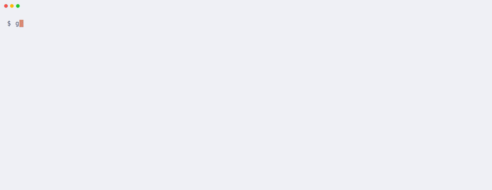

# gl-repos

[](https://github.com/ansgomez/gl-repos/actions/workflows/ci.yml)
[](https://github.com/ansgomez/gl-repos/releases)
[](go.mod)
[](LICENSE)

Interactive terminal dashboard for every git repository under a directory,
GitLab first (through `glab`), GitHub supported too (through `gh`).
See at a glance which repos are dirty, ahead/behind, on a non-default
branch, or not tracking `origin`, then fetch, pull, or push them from the
list, preview the commit graph, jump into lazygit, a shell or a coding
agent, clone, create or publish repositories on GitLab or GitHub, or ask a
local Ollama model to commit/stash/branch for you (always confirmed first).

<picture>
  <source media="(prefers-color-scheme: dark)" srcset="docs/demo-dark.gif">
  
</picture>

<sub>Recorded against sample repositories with stand-ins for glab, ssh
and Ollama. The AI response is scripted so the recording is
reproducible; with a real model, plans vary but are checked and
confirmed the same way. `make demo` re-records both themes (requires
[VHS](https://github.com/charmbracelet/vhs)).</sub>

## Features

- One list of every repository below a folder: branch, ahead/behind,
  commits against the default branch, staged/modified/untracked files.
- Fetch, pull (`--ff-only`) and push one repository or a selection.
- Commit graph preview; lazygit, your shell or a coding agent one key away.
- Clone with autocomplete from your GitLab or GitHub projects, or a whole
  GitLab group with its subgroups, in parallel with retries.
- Create a repository, or publish an existing one, on GitLab or GitHub.
- Profiles for several accounts; tokens stay with `glab` and `gh`.
- An optional local AI assistant (Ollama) that proposes git steps you confirm.

## Quick start

Needs git 2.31+, [`glab`](https://gitlab.com/gitlab-org/cli) (GitLab)
or [`gh`](https://cli.github.com) (GitHub) to clone from and publish to your forge,
and, to build from source, Go 1.26+.

```sh
git clone https://github.com/ansgomez/gl-repos.git gl-repos && cd gl-repos
make install                                    # puts gl-repos in $(go env GOPATH)/bin
export PATH="$(go env GOPATH)/bin:$PATH"        # if that is not on PATH yet
glab auth login --hostname gitlab.example.com   # GitLab; or gh auth login for GitHub
gl-repos -init                                  # optional: writes ~/.config/gl-repos/config.toml
gl-repos -doctor                                # checks config, git, tools, logins, token scopes, ssh, Ollama
gl-repos -d 2 ~/git                             # repos up to 2 levels below ~/git
```

Creating projects or subgroups (`n`, `u`) needs a GitLab token with the
`api` scope. [Getting started](docs/getting-started.md) walks through
each step, and [Troubleshooting](docs/troubleshooting.md) helps when
something fails.

## Install

Linux and macOS (Intel and ARM); git 2.31 or newer.

- **From source** (Go 1.26+): `make install` in a clone.
- **Release downloads**: archives, `.deb` and `.rpm` on the
  [Releases](https://github.com/ansgomez/gl-repos/releases) page. Check
  them with `sha256sum -c checksums.txt --ignore-missing`, then cosign.

[Install](docs/install.md) has the full steps, the optional tools and
how to verify a release with cosign and its build attestation.
[Linux](docs/linux.md) has the package commands for git, glab and gh.

## Keys

| Key | Action |
| --- | --- |
| `↑`/`↓`, `j`/`k` | Move |
| `space` / `a` | Toggle selection / select all visible |
| `f` / `p` / `h` | Fetch / pull (`--ff-only`) / push (asks to confirm) |
| `d` | Show only repos needing attention |
| `l` | Commit graph |
| `o` / `!` / `t` | Open lazygit / a shell / a coding agent in the repo |
| `c` | Clone a project from the active profile |
| `n` / `u` | New repository / publish the selected one |
| `w` | Switch profile |
| `i` | Ask the AI assistant |
| `enter` | Details pane |
| `q` | Quit |

The bottom line shows the keys. [Usage](docs/usage.md) lists every key,
flag and column.

## Security

gl-repos never handles forge tokens and never passes credentials to
git, glab or gh. Everything that changes a remote or runs AI-proposed
steps needs a key press to confirm, and a repository whose own git
config could run programs or redirect a connection is marked `!` and
asks first. See [the security design](docs/security.md) and
[SECURITY.md](SECURITY.md) (policy, reporting, guarantees).

## Documentation

- [Getting started](docs/getting-started.md): install, log in, config, first run
- [Install](docs/install.md): platforms, all install methods, release verification
- [gl-repos on Linux](docs/linux.md): installing git, glab and gh per distribution, where files live
- [Usage](docs/usage.md): flags, columns, the full key reference
- [Profiles and logins](docs/profiles.md): profiles, logging in with glab and gh, token scopes
- [Repositories](docs/repositories.md): new repositories, publishing, cloning, group clones
- [Agents and AI assistant](docs/agents-and-ai.md): coding agents, the AI assistant, recovery controls
- [Configuration](docs/configuration.md): config file, settings reference, environment
- [Troubleshooting](docs/troubleshooting.md): `-doctor` and common errors
- [Security design](docs/security.md): credentials, confirmation, the repository trust model
- [Development](docs/development.md): checks, CI and releases, tests
- [SECURITY.md](SECURITY.md), [CONTRIBUTING.md](CONTRIBUTING.md), [CHANGELOG.md](CHANGELOG.md)

## Development

`make ci` runs the checks CI runs. See [CONTRIBUTING.md](CONTRIBUTING.md)
to get started and [Development](docs/development.md) for CI, releases
and tests.

## License

MIT, see [LICENSE](LICENSE).

gl-repos is not affiliated with, endorsed or sponsored by GitLab Inc.
